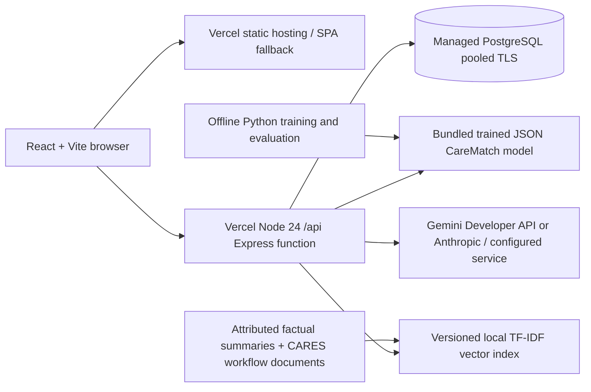
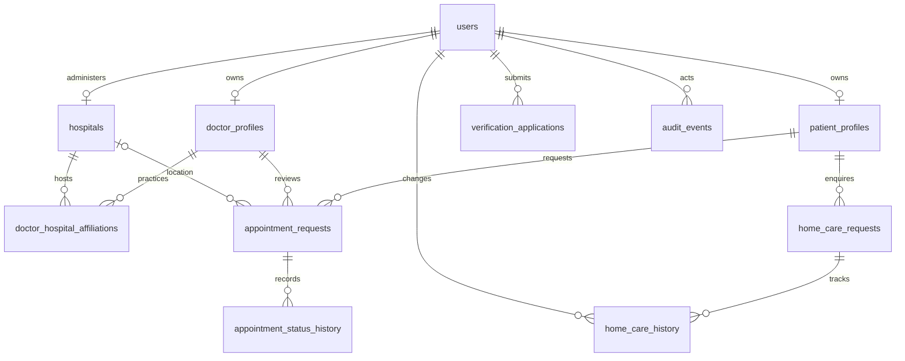
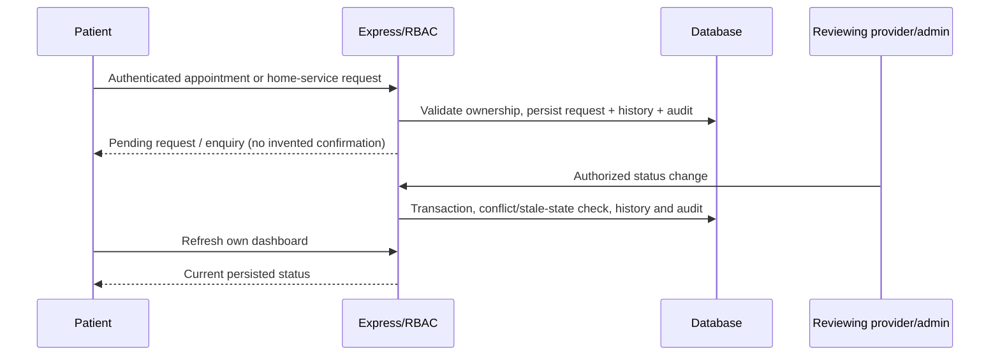

# CARES architecture

Updated 2026-10-29. Target: Vercel static React/Vite frontend, Vercel Node.js Express function and durable managed PostgreSQL (Neon recommended for pooled connections). No cloud resources have been created. The protected live SQLite database has not been opened or migrated.

The same routes serve local SQLite and PostgreSQL. `db/database.js` exposes asynchronous parameterized get/all/run/transaction operations. Existing synchronous SQLite maintenance scripts retain `connection.js`; they are never called by the function. SQLite transactions are serialized with async scope isolation. PostgreSQL uses a small per-process pool; each transaction acquires a client, begins, takes a consistent appointment-table lock, commits or rolls back, and releases the client. The coarse lock favors correctness for this small prototype; load testing and narrower locking are future work. State updates also compare the previous status to avoid stale transitions.

Production functions export `app` from `api/index.js` without listen, seeding, schema migration or model training. PostgreSQL migrations are explicit owner-run CLI operations with a checksum/version table and transaction. An existing unversioned database is refused. Frontend routes use same-origin `/api`; local Vite proxies to port 5000. SQLite cannot be selected by the Vercel entry point. Real Vercel rewrite behavior remains a preview validation gate.

`rate_limit_counters` stores short-lived keyed hashes of client IPs and window counters, independent of clinical entities. A single atomic PostgreSQL upsert enforces shared authentication and AI request limits across function instances. Local-only SQLite uses the existing in-process limiter. Production requires a bounded trusted-proxy configuration and verification of Vercel's client-IP forwarding in preview.

Role permissions are enforced in the API from the active database user, never from caller-supplied role/owner IDs. Pending doctor applicants can obtain a restricted application session through `/auth/application-login`; only their own review and clarification endpoints plus `/auth/me` are permitted until approval. Public directory accounts imported without login are still barred from authentication. There is no new public hospital or admin self-registration; an owner bootstraps the first production administrator privately, and institutional account provisioning remains owner-controlled.

Care at Home stores service type, requested date, contact phone, address and city. It does not collect diagnoses or medical documents. Patient ownership controls list, detail and cancellation. Only administrators can review. Status path: requested → under_review → contacted → closed, with declined/cancelled terminal paths. No assigned-provider, pricing or confirmed-visit state exists.

CareMatch runs exported TF-IDF/logistic weights in Node without Python, network calls or pickle loading. The prototype supports explicit specialty intents; symptoms and uncertain inputs abstain. Emergency keyword checks run before inference. Results come from the actual provider table, with synthetic and provenance fields retained. Compound directory specialties are matched by their recorded specialty prefix; no providers are generated.

RAG embeds six short paragraph chunks as sparse normalized TF-IDF vectors and retrieves cosine-ranked evidence. This small audited corpus does not justify an external vector store or paid embedding service yet; pgvector is a future option if corpus scale and semantic-recall evaluation warrant it. The LLM receives only service questions and retrieved public/documentary evidence. Private appointment queries are separate allowlisted SQL-backed lookups and are never added to LLM context. Citation IDs must resolve to actually retrieved chunks; titles/URLs/excerpts are supplied by the backend. This verifies citation identity, not every semantic claim. Human and live-model faithfulness evaluation is still required.

Authentication retains the existing bearer-token/localStorage client for compatibility. Passwords use bcrypt; new registrations require at least 10 characters and at most 72 UTF-8 bytes. Production JWT placeholders are rejected. Shared-cache storage is disabled for API responses. Responses sanitize server errors; logs omit request bodies and raw database error detail. Browser CSP limits scripts and connections to self. Remaining risks include localStorage token theft after XSS, lack of token-level logout revocation, heuristic prompt/safety filters and no clinical validation.

## Provider update

`ai/llmProvider.js` selects Gemini or Anthropic behind the existing evidence validator. Gemini uses a bounded JSON schema response, filters thought text, rejects blocked/truncated outputs and normalizes token usage including reported thought tokens. Its API key is sent only in `x-goog-api-key`, not the URL. Both transports retain the 15-second timeout; 429 responses are surfaced without automatic provider fallback. The retrieval index, CareMatch model, authorized tools and database layer are unchanged by provider selection. Gemini account/free-tier eligibility is an owner configuration gate, not inferred by the application.
